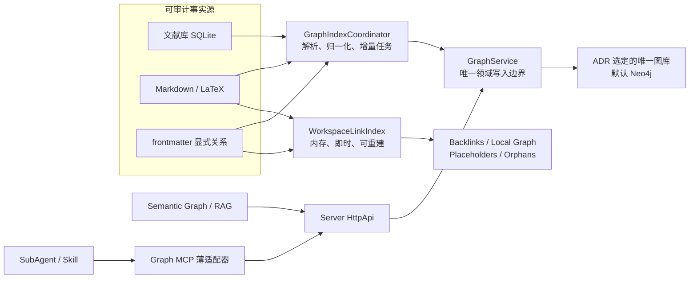

# 模块二：知识图谱中心技术方案

> 状态：重写版，替代原“SQLite 边表起步、未来迁移 Kuzu”的方案。
>
> 默认决策：采用 **Neo4j 5.26 LTS Community Edition**。Phase 0 只做一次有时间盒的 LadybugDB 替代性 spike；只有它通过全部兼容性门槛并显著降低桌面资源与分发成本，ADR 才允许改选。Phase 1 只实现最终选定的单后端，ResearchOS 不实现图存储、图查询执行器或图索引。
>
> 本文与 `docs/ResearchOS最终方案.md`、`docs/代码结构与上游同步.md`、`docs/dependency-inventory.md` 中的 SQLite/Kuzu 描述冲突时，以本文为准，相关总览文档应在本模块进入开发前同步修订。

---

## 1. 审核结论

原方案不建议继续实施。问题不在于 SQLite 不能保存节点和边，而在于它把一个图数据库应承担的能力拆散后交给业务代码自行维护：

1. **图查询是自研的**：k-hop、路径、方向、去重、分页和子图裁剪都需要自行实现，复杂查询最终会演变成递归 CTE 与应用层遍历的混合执行器。
2. **一致性边界不成立**：MCP、plugin 和 HTTP handler 都能直接打开同一个 SQLite 文件，业务约束与事务逻辑分散在多个进程中。
3. **数据模型缺乏证据与来源语义**：原来的唯一键 `(from_id, to_id, relation)` 会压掉同一关系的多条证据；删除某个来源时，也无法正确判断关系是否仍被其他来源支持。
4. **检索链路由多个实验性部件拼接**：FTS5、sqlite-vec、自行生成嵌入、自行做 k-hop、自行拼 context pack，故障降级和结果排序均需长期维护。
5. **迁移承诺不可信**：先按 SQLite 的表模型与查询接口开发，再“无感切换 Kuzu”并不现实；图库的事务、类型、索引、Cypher 方言和结果结构都会泄漏到接口层。
6. **Kuzu 已不再适合作为升级目标**：Kuzu 官方仓库已于 2025-10-10 归档并转为只读，不能继续依赖旧包；其后继项目 LadybugDB 必须视为新的候选重新验证，不能把“Kuzu 升级路径”直接改名沿用。参见 [Kuzu 官方仓库](https://github.com/kuzudb/kuzu)与 [LadybugDB 官方仓库](https://github.com/LadybugDB/ladybug)。
7. **现有实现仍是脚手架**：`packages/researchos-graph` 只有正则解析和自制力导布局，server handler 与前端均返回或展示 mock 数据。现在更换架构的成本远低于数据库逻辑落地之后。

因此，本次重写采用“**成熟图数据库 + 可重建投影 + 单一写入边界**”方案。

### 1.1 开源项目对标（2026-07-27）

GitHub 热度只用于确认项目经过广泛使用，不替代架构判断。以下 star 为调研日的近似值：

| 项目 | GitHub 热度 | 值得吸收的设计 | 不直接照搬的部分 |
| --- | ---: | --- | --- |
| [SiYuan](https://github.com/siyuan-note/siyuan) | 45k+ | 块级引用、双链、稳定 block ID、CLI/API、变更预览 | 自有块文件格式与完整编辑器内核 |
| [Logseq](https://github.com/logseq/logseq) | 44k+ | page/block 双层图、Datalog 查询、PDF annotation link、local-first | DB graph 仍处快速演进期，不复制其存储迁移路线 |
| [TriliumNext](https://github.com/TriliumNext/Trilium) | 37k+ | 属性与命名 relation、自动 Note Map 与人工 Relation Map 分离 | 数据库作为唯一事实源，不符合本项目 Markdown/Git 目标 |
| [Foam](https://github.com/foambubble/foam) | 17k+ | Markdown 为事实源、占位链接、孤立节点、歧义诊断、重命名同步、section/block link、CLI/MCP 共用同一图 | 仅文件链接图不足以承担科研语义 Graph RAG |
| [Obsidian Graph](https://obsidian.md/help/plugins/graph) | 闭源应用 | global/local graph 分离、depth、搜索过滤、groups、orphans、方向和力参数 | Graph View 是探索界面，不等同于语义知识库 |
| [Graphiti](https://github.com/getzep/graphiti) | 29k+ | episode/provenance、时序事实、受控/自定义 ontology、混合检索、MCP | Python + LLM 抽取框架过重；不作为 ResearchOS 核心依赖 |
| [LightRAG](https://github.com/HKUDS/LightRAG) | 38k+ | chunk/entity/relation 分层、local/global/mix 模式、reranker、检索评测 | 四套可插拔存储会扩大运维面，不整体引入 |
| [Microsoft GraphRAG](https://github.com/microsoft/graphrag) | 34k+ | text unit、entity/claim、local/global/DRIFT 分层查询、community report | 索引成本高，官方也提示应从小规模开始；global/community 不进 MVP |
| [LadybugDB](https://github.com/LadybugDB/ladybug) | 1k+ | Kuzu 后继、MIT、嵌入式、Node 包、Cypher、FTS/vector、无 JVM sidecar | 项目较新，必须先验证 Bun/Windows、崩溃恢复和发布质量 |

对标后形成六条修订原则：

1. **链接图与语义图分层**：编辑器即时双链体验由内存 `WorkspaceLinkIndex` 提供；Neo4j/LadybugDB 负责持久化语义投影和 Graph RAG。
2. **本地图优先**：默认打开当前节点的 local graph，不把“全库力导图”当作主要入口。
3. **块级证据优先**：检索和引用落到 `SourceChunk`，实体/关系只负责结构，不能只保存一段易漂移的 context 字符串。
4. **确定性关系与 AI 关系分开**：wikilink/cite 自动确认，语义关系必须经过 proposal/approval。
5. **查询模式显式**：basic、local、mix 分开；不在没有 community index 时伪装支持 global research summary。
6. **默认方案可被证据推翻**：Neo4j 是默认；LadybugDB 只做替代性 spike。实验代码不进入生产，最终只实现一个后端。

## 2. 目标与非目标

### 2.1 本期目标

- 建立文献、笔记、概念和代码仓库之间可追溯的属性图。
- 支持 `[[wikilink]]`、LaTeX `\cite{}`、文献引用数据和显式关系声明的增量索引。
- 支持邻居、路径、引用链、技术演进和限定范围子图查询。
- 基于 ADR 选定图库的全文索引、向量索引与受限 Cypher 遍历实现可解释的 Graph RAG。
- 提供图谱浏览、筛选、节点详情、证据查看和问答结果高亮。
- 数据保留在用户本机；断网时除外部文献检索与远程嵌入外，核心功能可用。
- 图数据库损坏或版本升级失败时，可以从事实源完整重建。

### 2.2 本期不做

- 不实现或维护自制图数据库、图查询语言、图索引和图算法引擎。
- 不引入 Kuzu、SQLite 边表或同时支持多个图数据库后端。
- 不做图库集群、高可用、在线备份和多用户权限模型。
- 不允许 Agent 直接执行任意 Cypher 或直接写语义图库。
- 不把前端布局坐标、临时筛选状态等 UI 数据写入领域图谱。
- 不承诺从 PDF 正文自动抽取高质量知识关系；PDF 深度解析仍由文献模块负责。

## 3. 技术决策

### 3.1 Neo4j 5.26 LTS 作为可靠性基线

| 维度 | 决策依据 |
| --- | --- |
| 图能力 | 原生属性图、Cypher、ACID 事务、约束、路径与可变长度遍历，不需要在业务层重建查询执行器。 |
| 混合检索 | Community Edition 支持全文索引与向量索引，可在同一图中完成种子召回和关系扩展。 |
| 客户端 | 使用官方 `neo4j-driver`，通过 Bolt 协议连接；驱动负责连接池、事务和瞬时故障重试。 |
| 稳定性 | 固定到 5.26 LTS 的最新补丁版本，不跟随月度功能版滚动升级。当前实施基线为 `5.26.28`，升级只允许同一 LTS 内补丁版本。 |
| 部署 | 单机进程即可，开发和 CI 使用官方 Docker 镜像；桌面版使用受管本地进程，数据目录独立于工作区。 |
| 许可 | Neo4j Community Edition 为 GPLv3，官方 JavaScript Driver 为 Apache-2.0。开发使用没有障碍；桌面安装包若捆绑并分发 Neo4j，发布前必须完成 GPLv3 合规审查并附带对应许可与源码获取方式。 |

官方依据：

- [Neo4j 5.26 LTS 文档与版本归档](https://neo4j.com/docs/reference/docs-archive/)
- [Community Edition 能力对比](https://neo4j.com/docs/operations-manual/current/introduction/)
- [Neo4j 索引类型](https://neo4j.com/docs/cypher-manual/current/indexes/)
- [Neo4j 向量索引](https://neo4j.com/docs/cypher-manual/current/indexes/semantic-indexes/vector-indexes/)
- [Neo4j JavaScript Driver](https://neo4j.com/docs/javascript-manual/current/)
- [Neo4j Community Edition 许可](https://neo4j.com/legal-terms/)

### 3.2 Phase 0：LadybugDB 替代性 spike

LadybugDB 是 Kuzu 项目的后继，而不是旧 Kuzu 包的继续维护版本。它的嵌入式部署更符合 Obsidian/Foam 一类桌面本地知识库：无需 JVM、端口、认证、每课题进程和 A/B server 切换。但其社区规模和实际发布历史明显小于 Neo4j，因此不能仅凭 README 直接替换。

Phase 0 使用同一份 1 万节点/5 万关系 fixture 建立 Neo4j 基准，并验证 LadybugDB 能否替代默认方案：

| 决策项 | Neo4j 5.26 LTS | LadybugDB |
| --- | --- | --- |
| Bun/Node 接入 | 官方 `neo4j-driver` + Bolt | `@ladybugdb/core` 原生包；重点验证 Bun ABI |
| Windows/macOS/Linux | JVM/容器路径成熟 | 验证预编译二进制完整性和代码签名 |
| 本地资源 | JVM 与独立进程较重 | 嵌入式，理论上更低 |
| FTS/vector/Cypher | 已验证的产品能力 | 逐条跑兼容性与正确性测试，不按名称推定一致 |
| 多读单写/崩溃恢复 | server ACID 与官方工具成熟 | 强制 kill、断电模拟、文件损坏与 reopen 测试 |
| 全量重建 | 维护窗口内构建新 generation 并切换 | 维护窗口内构建新 generation 并切换；均不复制运行中数据库文件 |
| 分发许可 | Neo4j CE GPLv3；需合规评审 | MIT；仍需核查二进制第三方许可证 |
| 可观测性/运维 | 成熟 | 需要 ResearchOS 补充 health/diagnostics |

LadybugDB 改选条件是：三平台 CI 与 Bun ABI 全通过；与基准 fixture 的 FTS/vector/1–2 hop 结果一致；24 小时加速 soak 零数据损坏、100 次强制 kill/reopen 零已提交事务丢失；升级与并发读写通过；并且相对 Neo4j 的桌面安装体积或典型峰值 RSS 至少降低 50%，冷启动 P95 不劣于 Neo4j。任一 must-have 失败、优势不显著或时间盒结束仍无法确认，均保留 Neo4j。30 天真实使用 burn-in 是 beta 发布门，不阻塞 Phase 1。决策后删除实验代码；不得引入通用多后端 `Store` 抽象。

### 3.3 为什么不选其他方案

| 方案 | 结论 | 原因 |
| --- | --- | --- |
| SQLite 节点表/边表 | 排除 | 保存边容易，但遍历、路径、证据、多来源、索引协同和迁移均落到业务代码。 |
| Kuzu | 排除 | 官方项目已归档，不适合作为新产品的长期依赖。 |
| LadybugDB | 替代性 spike | 是 Kuzu 后继且适合本地嵌入，但只有通过 3.2 的门槛且优势显著才改选。 |
| Memgraph | 暂不选 | 技术能力可满足，但社区版/OEM 分发条款需要额外评估，且本项目没有必须采用流式图计算的需求。 |
| ArangoDB | 暂不选 | 多模型能力超出本模块需要，部署与许可面更复杂；ResearchOS 已有 SQLite 负责关系型数据。 |
| Neo4j Aura | 可选远程模式 | 运维简单但不满足默认本地优先；后续可作为团队协作版连接目标，不作为 MVP 默认依赖。 |

本期只实现 ADR 最终选定的一个图数据库，避免为“未来可能替换”设计最低公分母 `Store` 接口。领域服务边界稳定即可，数据库适配器不作为公共 API。

## 4. 总体架构

图数据库是**可重建语义查询投影**，不是唯一事实源；`WorkspaceLinkIndex` 是可随时丢弃的内存索引，也不是数据库：

- 文献元数据与引用关系的事实源：文献模块 SQLite。
- 笔记、概念页、LaTeX 和显式关系的事实源：工作区文件，可进入 Git。
- `WorkspaceLinkIndex`：从文件 AST 增量生成的内存映射，只负责即时链接、反向链接、占位/孤立诊断和 local graph；不持久化、不执行任意图查询。
- 选定图库：从事实源构建的持久化语义投影，用于 typed relation、全文/向量召回、受限遍历和 Graph RAG。
- UI 布局：前端本地状态，按 `projectId` 保存，不进入 Neo4j。



### 4.1 两层图的职责边界

| 能力 | `WorkspaceLinkIndex` | 语义图数据库 |
| --- | --- | --- |
| 启动与可用性 | 打开工作区立即构建；图库离线仍可用 | 独立 health，可降级 |
| 数据 | 文件、heading、block、wikilink、Markdown link、tag、alias | Paper/Concept/Repository/SourceChunk、typed relation、embedding |
| 查询 | 精确 lookup、incoming/outgoing、`depth <= 2` 的 BFS；最多 500 节点/1,000 边 | 参数化 Cypher、全文/向量、证据检索 |
| 写入 | 不直接写；rename/refactor 走 Workspace 文件事务 | 只接受事实源投影和 confirmed relation |
| 持久化 | 无；进程重启重建 | 有；损坏时从事实源重建 |
| API | backlinks、local graph、unresolved、orphans | semantic graph、Graph RAG、proposal |

两层共用同一个 parser 输出 `GraphDocument`，避免各自解释 wikilink。`WorkspaceLinkIndex` 只允许 Map/Set 与上述有界 BFS；硬性禁止 embedding、全文索引、typed semantic relation、任意 path query、跨来源相关性排序和插件自定义 predicate，避免它膨胀为第二套图引擎。

`GraphDocument` 是纯领域快照，至少包含 `source`、`sourceHash`、文件级 metadata、heading/block anchors、确定性 links、typed assertions、`SourceChunk[]` 和 diagnostics。链接索引只消费 anchors/links/diagnostics，语义投影消费 entities/chunks/assertions；两侧不得重新解析原始文本。

### 4.2 单一写入边界

`GraphService` 是 server 的统一 facade，但内部边界保持分离：所有语义图读写经过 repository；backlinks/local graph/诊断直接委托 `WorkspaceLinkIndex`，不得绕入图库 repository。

- `GraphIndexCoordinator` 调用 `GraphService.replaceSource(...)`。
- HttpApi handler 调用 `GraphService`。
- MCP server 只调用 ResearchOS HttpApi，不直接连接 Neo4j。
- plugin 不再 import 数据库包，也不直接写图；如果需要监听事件，只负责通知 server 安排重建。
- 前端和 Agent 均不能提交任意 Cypher。

这一边界消除了原方案中 MCP、plugin、server 三方并发维护同一数据库文件的问题。

## 5. 部署与生命周期

本节写出默认 Neo4j 的运行模型。若 LadybugDB spike 成功，只保留 Location-scoped owner、generation 目录、manifest 与恢复原则，删除 JVM、端口、Bolt、认证和外部进程 supervisor；不得把 Neo4j 专属运维逻辑伪装成通用抽象长期保留。

### 5.1 实例模型

- **每个课题使用一个 Neo4j 单机实例**，Community Edition 使用该实例的默认 `neo4j` 数据库。这样全文/向量索引天然按课题隔离，也避免 Neo4j 5.26 的向量查询无法在 ANN top-K 前按 `projectId` 过滤而导致漏召回。
- `GraphRuntime` 是 Location-scoped：打开课题时按需启动。MVP 同时只运行当前课题的一个本地实例；切换课题时停止上一实例，再启动新实例。切换 P95、常驻/峰值 RSS 不达 Phase 0 预算即视为 Neo4j 桌面模式失败，而不是留给后续优化。
- 数据目录放在 ResearchOS 应用数据目录的 `graphs/<projectId>/`，不放入工作区、Git 或同步盘。端口由 supervisor 从 loopback 动态分配，不使用所有项目共享的固定端口。
- 节点仍保留 `projectId` 作为纵深防御和导出标识；任何返回不同 `projectId` 的记录都视为数据损坏，而不是正常多租户数据。
- 每个实体保留稳定领域标识 `entityId = <kind>:<domainId>`；物理唯一键为 `uid = <projectId>:<entityId>`。
- 每课题保留 active generation、最多一个 previous generation 和一个临时 building generation。MVP 全量重建进入明确的语义图维护模式，不实现在线 shadow replay、双 driver 排空或无停机承诺。

```text
<app-data>/graphs/<projectId>/
├── control/
│   ├── active-generation.json # 原子替换；仅指向带 complete marker 的 generation
│   └── owner.lock             # 操作系统文件锁
└── generations/
    ├── <active-id>/           # Neo4j home/data + source manifest + complete marker
    ├── <previous-id>/         # 最近一次健康版本；确认新版本后清理
    └── building-<job-id>/     # 临时目录；失败可直接隔离或删除
```
- 禁止把某个工作区目录直接挂成 Neo4j 数据目录，避免 Git、同步盘和数据库文件锁相互影响。

### 5.2 三种运行方式

| 场景 | 方式 |
| --- | --- |
| 开发 | `docker compose` 启动固定版本 `neo4j:5.26.28`，只绑定 `127.0.0.1:7687`，数据使用命名 volume。 |
| CI | 每个测试 job 启动一次性 Neo4j service container；测试套件结束后销毁 container/volume。 |
| Desktop | ResearchOS supervisor 按课题管理固定版本 Neo4j 与兼容 JRE 21：动态端口、启动、健康检查、闲置回收、异常退出提示和优雅关闭。首次运行下载或安装，发布包是否内置取决于许可与体积评审。 |

### 5.3 配置与凭据

```json
{
  "researchos": {
    "graph": {
      "mode": "managed-local",
      "database": "neo4j",
      "embedding": {
        "provider": "local",
        "model": "sentence-transformers/all-MiniLM-L6-v2",
        "dimensions": 384
      }
    }
  }
}
```

- 用户名与密码不得写入 `opencode.json` 或仓库，保存到现有凭据系统或操作系统密钥链。
- `managed-local` 模式的 URI、端口和进程号由 supervisor 维护，不写入项目配置；`external` 模式才允许显式配置 URI。
- `external` 模式必须为当前课题提供独占数据库；Community Edition 连接目标不得被多个课题共用。
- `external` 模式只支持查询、增量索引和维护窗口内的停机全量重建；MVP 不定义双 endpoint 无停机切换协议。
- 启动时执行 `verifyConnectivity()`、版本检查和 schema 迁移；版本不兼容时拒绝写入并给出修复命令。
- 端口只监听 loopback；远程 Neo4j 必须显式配置 TLS。

## 6. 图数据模型

### 6.1 节点

统一基础标签为 `Entity`，再附加一个领域标签：

| 标签 | 稳定标识 | 事实源 | 关键属性 |
| --- | --- | --- | --- |
| `Paper` | 文献模块 `paperId`；DOI 仅作为可选外部标识 | 文献 SQLite | `uid`, `entityId`, `projectId`, `paperId`, `title`, `doi`, `abstract`, `year`, `sourceHash` |
| `Note` | vault 相对路径 | Markdown/LaTeX | `uid`, `entityId`, `projectId`, `path`, `title`, `body`, `sourceHash` |
| `Concept` | 创建时生成的不可变 `conceptId` | 概念页/显式声明 | `uid`, `entityId`, `projectId`, `conceptId`, `slug`, `name`, `aliases`, `conceptType`, `redirectTo`, `body`, `sourceHash` |
| `Repository` | 规范化仓库 URL | 显式声明/文献元数据 | `uid`, `entityId`, `projectId`, `url`, `name`, `sourceHash` |
| `SourceChunk` | `sourceEntityId + blockId/headingAnchor + chunkHash` | 文件 AST / 文献摘要 | `uid`, `entityId`, `projectId`, `sourceEntityId`, `anchor`, `text`, `ordinal`, `sourceHash` |

`Concept.conceptType` 的 MVP 内置值为 `method | dataset | task | metric | topic`。图库可为常用类型附加 `Method`、`Dataset`、`Task`、`Metric` 次级 label，但 API 始终返回稳定的 `conceptType`，不能让数据库 label 成为公共协议。

Concept 创建时生成不可变 `conceptId`（ULID），slug、名称和 alias 都是可修改属性，不能再把 slug 当长期主键。重命名只更新属性与链接显示；合并时保留旧 ID 的 `redirectTo` 并重写引用，拆分必须由用户为每个新概念重新确认关系证据。redirect 链最长一跳，collision/循环在写回前拒绝。

`SourceChunk` 是 Graph RAG 的最小证据和向量检索单元：

- anchor 优先级：显式 `^block-id` → heading path + 段内序号 → 文献摘要固定 anchor。
- 普通段落移动可能改变自动 anchor；UI 应鼓励对被引用证据生成显式 block ID。
- `Note.body` 只供预览与全文兜底，默认不为整篇长文生成 embedding；embedding 写入 `SourceChunk` 和短实体摘要。
- `(Note|Paper)-[:CONTAINS]->(SourceChunk)` 表示归属；chunk 删除或变化时按 source 原子替换。

约束与索引由版本化 Cypher migration 创建：

```cypher
CREATE CONSTRAINT entity_uid IF NOT EXISTS
FOR (n:Entity) REQUIRE n.uid IS UNIQUE;

CREATE INDEX entity_project IF NOT EXISTS
FOR (n:Entity) ON (n.projectId);

CREATE INDEX entity_projection IF NOT EXISTS
FOR (n:Entity) ON (n.projectId, n.entityId);

CREATE FULLTEXT INDEX entity_text IF NOT EXISTS
FOR (n:Paper|Note|Concept|SourceChunk) ON EACH [n.title, n.name, n.abstract, n.body, n.text];

CREATE VECTOR INDEX entity_embedding IF NOT EXISTS
FOR (n:Entity) ON n.embedding
OPTIONS { indexConfig: {
  `vector.dimensions`: 384,
  `vector.similarity_function`: 'cosine'
}};
```

向量在 Community Edition 中保存为 `LIST<FLOAT>`。变更模型或维度必须创建新属性与新索引，例如 `embedding_v2`，完成回填后再切换查询，禁止原地混用不同维度。

### 6.2 关系与方向

| 关系 | 方向 | 产生方式 |
| --- | --- | --- |
| `CITES` | `Paper|Note -> Paper` | `\cite{}`、文献库引用数据、明确的 paper wikilink |
| `MENTIONS` | `Paper|Note -> Concept|Repository|Paper` | `[[...]]` 或显式声明 |
| `IMPLEMENTS` | `Repository -> Paper|Concept` | 仅显式关系或人工确认的 Agent 建议 |
| `EVOLVES_FROM` | `Concept|Paper -> Concept|Paper` | 仅显式关系或人工确认的 Agent 建议 |
| `USES_DATASET` | `Paper|Concept -> Concept(dataset)` | 显式关系或人工确认的 Agent 建议 |
| `EVALUATES_ON` | `Paper|Concept -> Concept(task|metric)` | 显式关系或人工确认的 Agent 建议 |
| `SUPPORTS` / `CONTRADICTS` | `Paper|Concept -> Paper|Concept` | 仅人工确认；必须带证据块 |

每条关系是一次有来源的断言，而不是只由起点、终点和类型确定的事实。关系至少包含：

- `evidenceKey`：对 `sourceEntityId + relation + targetEntityId + 稳定定位符 + contextHash` 做 SHA-256，用于幂等 `MERGE`；不得使用易受段落插入影响的数组序号。
- `projectId`、`sourceEntityId`、`sourcePath`：项目与证据来源。`sourceEntityId` 不含数据库 generation，重建后仍稳定。
- `evidenceChunkUid`：由事实源中的 `evidenceRef` 确定性解析到 `SourceChunk`；`contextPreview` 只是 UI 快照，不能作为唯一证据。
- `origin`：`parser | literature | agent | user`。
- `status`：投影内只允许 `confirmed`。Agent 建议保存在 proposal 控制面，批准写回事实源后才进入 Neo4j。
- `createdAt`、`updatedAt`。

允许同一对节点存在多条同类型关系，因为不同文献或段落可以独立支持同一结论。UI 默认聚合展示，详情面板展开证据。

repository 使用起点、终点、关系类型和 `evidenceKey` 做参数化 `MERGE`。单 owner 与 project coordinator 避免并发创建重复关系；测试必须额外断言同一 evidence 不重复，不能假设节点唯一约束会自动约束关系。

### 6.3 受控本体

内置四种关系不足以表达科研问题，但允许 Agent 任意发明 predicate 会迅速污染图谱。因此采用版本化 registry：

```yaml
# vault/.researchos/graph-schema.yaml
version: 1
relations:
  uses_dataset:
    from: [paper, concept]
    to: [concept:dataset]
    inverse_label: used_by
  evaluates_on:
    from: [paper, concept]
    to: [concept:task, concept:metric]
    inverse_label: evaluated_by
```

- MVP 只允许内置 relation，避免 schema workflow 与业务审批同时落地。
- 后续项目自定义 relation 使用 `custom.<name>` 命名空间；registry 变更需要独立 schema proposal、用户审核、version 递增和全量校验。
- 在 schema proposal 的持久化格式、HttpApi 与 migration 回滚契约实现前，Agent 遇到未知类型只能使用 `MENTIONS`，不能提交或写入新 predicate。
- API 返回 relation 的 canonical name、显示名、inverse label 和方向，UI 不硬编码所有关系样式。

### 6.4 显式关系声明

不能可靠地从语法推断的关系写在事实源 frontmatter 中，而不是由 Agent 直接写数据库：

```yaml
graph:
  - relation: implements
    target: repo:https://github.com/Dao-AILab/flash-attention
    evidenceRef:
      sourceEntityId: note:notes/flash-attention.md
      anchor: ^official-implementation
      expectedChunkHash: sha256:...
    note: Official implementation
  - relation: evolves_from
    target: concept:multi-head-attention
    evidenceRef:
      sourceEntityId: note:notes/flash-attention.md
      anchor: ^io-aware-tiling
      expectedChunkHash: sha256:...
    note: Extends standard attention with IO-aware tiling
```

`evidenceRef` 是 confirmed 语义关系的必填字段；parser 必须验证来源、anchor 和 chunk hash 后才能生成 `evidenceChunkUid`。anchor 存在但 hash 变化时断言标记为 `stale` 并退出正式投影，UI 提供“查看新旧文本并重新绑定”的修复动作；不得按相似文本静默重绑。确定性的 wikilink/cite 可自动确认并以其语法位置生成 evidenceRef。Agent 建议经用户批准后写回上述结构，再由索引器投影。

## 7. 索引与一致性

### 7.1 全量重建

MVP 接受语义图短时不可用，换取简单、可证明的恢复模型；`WorkspaceLinkIndex` 全程可用：

1. `GraphIndexCoordinator` 取得项目 rebuild lease，读取文献模块单调 `revision`，并扫描工作区得到 `path -> sourceHash` manifest。若文献模块尚不能提供 revision，Phase 1 不得开始全量投影实现。
2. 停止当前 Neo4j 实例，保留 active generation 不修改；在 `building-<job-id>` 启动构建实例。Graph RAG 返回 `maintenance`，不读取部分新图。
3. 按快照 manifest 重新读取来源；任一文件 hash 或文献 revision 不匹配就中止本轮并重新捕获快照，最多自动重试 3 次，不能用 watcher 事件证明完整性。
4. 生成标准化 `GraphDocument`，分批写入 building generation，完成 embedding 回填，等待全文/向量索引 `ONLINE`，再校验节点/关系/chunk/diagnostic 数量和抽样查询。
5. 取得短时事实源 barrier，阻止文献提交和工作区 mutation；重新读取文献 revision 与全部 source-hash manifest。与步骤 1 完全一致才写入 durable manifest 和 `complete` marker，否则释放 barrier、丢弃本轮并重试。
6. 在 barrier 内原子替换 `active-generation.json`，启动并 `verifyConnectivity()` 新 generation；成功后释放 barrier。启动失败则把 pointer 指回旧 generation 并恢复旧实例。
7. 旧 generation 保留到新版本完成一次启动恢复测试或观察期结束，然后只保留最近一个 previous。启动时只信任 pointer 指向且带 valid complete marker 的 generation；残留 `building-*` 永不自动提升。

在线 shadow rebuild、变更日志追平、双 driver 排空与无停机切换明确不进 MVP。只有实测重建维护窗口超过 60 秒或产品出现持续后台索引需求时，才单独提交 ADR 评估这些能力。

### 7.2 增量更新

- server 监听规范化后的文件变更事件，按 `projectId + sourcePath` 防抖并串行化同一来源任务。
- 读取内容后计算 `sourceHash`；哈希未变则跳过。
- 同一份 `GraphDocument` 先原子替换 `WorkspaceLinkIndex` 中该来源的条目，再异步提交语义图投影；因此保存文件后 backlinks/local graph 立即可见，图数据库离线也不阻塞编辑体验。
- 在单个 Neo4j 写事务中完成：upsert 来源节点、按 `projectId + sourceEntityId` 删除旧断言、写入新断言、更新哈希。查询和删除都必须包含当前实例的 `projectId` 防御性条件。
- `SourceChunk` 与来源断言在同一事务中按 source 原子替换；embedding 可异步回填，但旧 chunk 不得继续作为证据返回。
- 文件删除时只删除该来源产生的断言；无其他入边且无独立事实源的派生节点进入孤儿清理任务，不立即级联误删。
- 文献模块通过领域事件或显式 reindex API 通知图谱，不允许图谱直接监听文献 SQLite 文件变化。

### 7.3 解析规则

- Markdown 使用 AST 解析，不对整篇文本做单一正则扫描；代码块、内联代码和转义内容不参与 wikilink 解析。
- 支持 `[[target]]`、`[[target|alias]]`、`[[target#heading]]`、`[[target#^block-id]]`、`![[embed]]` 与标准 Markdown 内链；保留文件、heading 与 block 定位。embed 与普通 link 在领域类型上分开。
- 解析 frontmatter alias、Markdown tag 和显式 block ID；忽略 `.git`、`.researchos`、构建产物及项目配置的 excluded paths。
- `\cite{key1,key2}` 必须通过文献模块 bibkey 映射解析；未命中时生成 unresolved diagnostic，不创建伪 Paper。
- 同名目标不能靠“paper → concept → note”的静态顺序猜测。精确 ID、相对路径和唯一 alias 命中后才能确认；不存在的目标保留为 placeholder，多个候选进入 ambiguous diagnostic，不创建伪语义实体。
- `WorkspaceLinkIndex` 由这些确定性结果即时计算 backlinks、local graph、placeholders 和 orphans；“未链接提及”按需用全文检索候选词并返回上下文，不能预先固化为关系。
- 重命名是有预览的 refactor：列出受影响链接，应用前校验每个来源的 `sourceHash`，冲突则停止并要求重新预览，不在后台静默改写用户文件。
- parser 输出纯领域对象，不包含 Neo4j Record、Node 或 Integer 类型。

## 8. Graph RAG

Graph RAG 是“召回、扩展、裁剪、作答”四段管线，不在数据库查询函数中直接调用 LLM。

### 8.1 查询模式

| 模式 | 候选来源 | 图扩展 | 最终排序与降级 | MVP |
| --- | --- | --- | --- | --- |
| `basic` | `SourceChunk` FTS + vector | 无 | RRF；vector 不可用时 FTS-only | 必做 |
| `local` | 实体摘要 FTS + vector，关联其 top chunks | 默认 1-hop，显式请求最多 2-hop | 实体 RRF + 图距离 + chunk 相关度；图库不可用时降级为 `basic` | 默认，必做 |
| `mix` | `basic` 的 chunk 候选与 `local` 的扩展证据集合 | 沿用 `local` 的有界子图，不再额外扩展 | 对去重后的 chunk 执行 cross-encoder rerank；reranker 不可用时降级为 `local` | 离线评测证明收益后开放 |
| `global` | community report | community 层级聚合 | map-reduce | MVP 返回 `unsupported` |

模式名是稳定的产品语义，不照搬某个开源项目的内部实现。每个响应都返回实际执行模式、降级原因与阶段耗时。

### 8.2 召回与排序

1. 对问题生成与当前 embedding manifest 中模型、维度、归一化方式一致的向量。
2. 按 8.1 的模式只查询规定索引；每一路默认 top 20，不把长文全文塞进实体 embedding。
3. 应用层使用 RRF 合并同一阶段的全文/向量结果，保留最多 30 个候选；不能把数据库原始分数直接相加。
4. `local` 先选最多 10 个实体种子再扩图；`mix` 只对 `basic + local` 去重后的 chunk rerank，最终最多 10 个 chunk。
5. 每次降级都修改响应中的实际 `mode`，同时返回 `requestedMode`、`degraded: true` 和原因，不能只打日志或静默伪装。

每项目独立数据目录保证 ANN 候选不会被其他项目占用；generation 重建也不会让新旧投影进入同一个索引。因此 top-K 后不需要以不可靠的应用层过滤弥补索引隔离。

### 8.3 子图扩展

- 使用参数化 Cypher，只遍历白名单关系。
- 默认 1-hop，用户明确请求关系链时最多 2-hop。
- 查询维护共享的全局 `remainingNodes`、`remainingRelationships` 与 visited set。每次单层查询的 limit 取 `min(perLayerLimit, remainingRelationships)`，结果去重后扣减全局预算；预算归零立即停止并返回 `truncated: true` diagnostics。第二层查询并发上限为 4，不能对全部一层节点无界并发。
- 每层仍设置局部上限；高出度 Paper 的引用边先按年份、证据状态和相关度裁剪。
- 只遍历 `status = confirmed`；pending proposal 根本不写入 Neo4j。
- 所有查询强制带 `projectId`；每层返回的节点和关系都再次校验 `projectId`，脏边不能把遍历带出当前项目。

示意查询只展示单层有界扩展；2-hop 由应用层对第一层去重后的节点再次执行同一查询。不能用一个可变长度 path 加最终 `LIMIT` 冒充逐层限额，因为数据库仍可能先枚举大量路径。

```cypher
MATCH (seed:Entity {projectId: $projectId, entityId: $entityId})
MATCH (seed)-[rel]-(neighbor:Entity)
WHERE neighbor.projectId = $projectId
  AND rel.projectId = $projectId
  AND type(rel) IN $allowedRelations
  AND rel.status = 'confirmed'
WITH rel, neighbor
ORDER BY coalesce(rel.updatedAt, 0) DESC, neighbor.uid
LIMIT $perLayerLimit
RETURN rel, neighbor;
```

### 8.4 上下文打包、引用与缓存

- context pack 包含节点稳定 ID、标题、关系方向、`SourceChunk` 文本和精确来源定位，不只包含 label 或关系上的 preview。
- 先按来源去重，再按相关性与图距离排序，最后按 token 预算裁剪。
- LLM 输出必须引用稳定 `sourceEntityId + anchor + chunkHash`；server 根据定位转成可点击的文献、heading 或 block 链接。source hash 已变化的缓存证据不得继续用于回答。
- retrieval cache key 至少包含 `projectId`、问题归一化 hash、查询模式、过滤条件、source-manifest hash、ontology version、embedding model/version 与 reranker version；任一变化都使缓存失效。
- 返回 `mode`、`seeds`、`subgraph`、`sources`、`degraded`、`truncated` 和 `diagnostics`，便于 UI 解释“为什么命中”。

## 9. 服务与接口边界

### 9.1 包职责

`packages/researchos-graph` 保留，但不再是“图数据库核心库”，而是 server 使用的领域模块：

```text
packages/researchos-graph/src/
├── types.ts          # 领域输入/输出；不导出 neo4j-driver 类型
├── parse.ts          # Markdown/LaTeX -> GraphDocument
├── normalize.ts      # ID、URL、slug、alias 规范化
├── link-index.ts     # 内存 backlinks/local graph/诊断
├── ontology.ts       # MVP 内置节点/关系类型；自定义 schema 后置
├── chunks.ts         # 稳定 chunk、anchor 与引用定位
├── migrations.ts     # 版本化 Cypher schema migrations
├── repository.ts     # 私有 Neo4j 查询实现
├── service.ts        # GraphService 领域边界
├── indexer.ts        # 全量/增量索引编排
├── rag.ts            # 查询模式、混合召回、子图裁剪、context pack
└── evaluation.ts     # 固定数据集与检索质量评测
```

- `neo4j-driver` 只出现在该包内部。
- 该包可依赖 Schema/Protocol 所需的纯类型，但不得依赖 Core/Server。
- Server 负责 Location、配置、凭据、生命周期与 HttpApi handler。
- MCP 适配器不复用 repository，只调用 HttpApi。
- 每个项目的 `GraphRuntime` 在进程内只有一个 owner。supervisor 对 `graphs/<projectId>/owner.lock` 持有操作系统文件锁并写入随机 owner token；另一个 server 进程不能取得锁时不得启动该项目实例或执行写操作。
- rebuild、增量索引和 proposal approval 进入同一个 project-scoped coordinator 队列；只有查询可以并发。GraphService 是代码边界，owner lock 与有序队列才是运行时单写者保证。

### 9.2 HttpApi

现有 `researchos-graph.ts` 协议是 stub，需要按以下能力重新设计：

| Endpoint | 用途 |
| --- | --- |
| `GET /api/graph/status` | 已选图库连通性、版本、schema、索引状态、active generation、降级状态。 |
| `POST /api/graph/reindex` | 发起全量或按来源重建，返回 job ID；不在请求内阻塞完成。 |
| `GET /api/graph/jobs/:id` | 查询重建进度、失败诊断和统计。 |
| `GET /api/graph` | 按类型、关系、时间、中心节点与深度查询有限子图；必须分页或带上限。 |
| `GET /api/graph/node` | 节点详情、聚合邻居和逐条证据。 |
| `GET /api/graph/links/backlinks` | 即时 linked mentions；图数据库离线仍可用。 |
| `GET /api/graph/links/local` | 从中心文档执行有界 BFS 的 local graph。 |
| `GET /api/graph/links/diagnostics` | placeholders、orphans、ambiguous links 与未命中 cite。 |
| `POST /api/graph/links/rename-preview` | 生成重命名改写清单和预期 source hash。 |
| `POST /api/graph/links/rename-apply` | 校验预览版本后原子应用文件修改。 |
| `POST /api/graph/query` | Graph RAG 检索；返回子图、来源和 context pack，不在 GraphService 内生成 answer。 |
| `POST /api/graph/answer` | 接收 `retrievalId` 和问题，创建受限的 SessionV2 prompt，返回 `sessionID/messageID`；回答通过现有 Session 事件流传输，取消使用现有 Session interruption。 |
| `POST /api/graph/proposals` | 提交 Agent 关系建议。 |
| `POST /api/graph/proposals/approve` | 批准建议并写回事实源，然后触发增量索引。 |

协议变更后必须从 `packages/client` 运行 `bun run generate`，不得手改 `src/generated` 或 `src/generated-effect`。

Protocol 使用判别联合而不是可选字段堆叠：查询结果为 `ready | degraded | maintenance | unsupported`，job 为 `queued | running | succeeded | failed | cancelled`，链接诊断为 `placeholder | ambiguous | missing_citation | stale_evidence`。列表统一使用 opaque cursor 与服务端硬上限；mutation 接受 `Idempotency-Key`，rename/approval 同时要求 `expectedSourceHash`。稳定 ID 一律是不透明字符串，客户端不得从 slug/path 推导。

`graph.query` 将 context pack 放入有 TTL、绑定 `projectId + user/session` 的 server-side retrieval cache，并返回不可猜测的 `retrievalId`。`graph.answer` 只能读取同一调用者的 retrieval；Session 合成结果通过结构化 metadata 回填 `sources`，前端据此渲染引用。GraphService 仍不依赖 Session、Core 或 Server，调用 SessionV2 的编排位于 server handler。

### 9.3 MCP 工具

MCP 只暴露受约束的业务动作：

- `graph_backlinks`：返回 linked mentions 与上下文；Phase 4 评测通过后才可选计算 unlinked mentions。
- `graph_local`：返回指定文档、深度和过滤条件下的本地链接图。
- `graph_search`：全文/向量检索节点。
- `graph_neighbors`：查询限定深度邻居。
- `graph_query`：返回 Graph RAG 证据包。
- `graph_propose_relation`：提交待审核关系。
- `graph_reindex_source`：重建明确指定的工作区来源。

删除原来的通用 `graph.upsert` 与 `graph.layout`。模型不得绕过业务校验任意写节点、边或布局。

### 9.4 Proposal 持久化与审批

- pending proposal 持久化为项目内 `vault/.researchos/graph/proposals/<proposalId>.json`，它是控制面记录，不是 confirmed 图事实，默认加入 `.gitignore`。
- 记录包含 `proposalId`、稳定 source/target entity ID、内置 relation、结构化 `evidenceRef`、可选 `note`、`targetSourcePath`、`expectedSourceHash`、状态和时间戳；提交时 evidenceRef 必须能命中当前 chunk。
- proposal 状态机为 `pending -> approved | rejected`，同一 `proposalId` 的重复请求幂等。
- `targetSourcePath` 必须在提交时确定：Paper 使用对应 `vault/papers/<paperId>.md` companion note；Repository 关系写入提出该断言的 Note/Concept；没有合法承载文件的建议拒绝提交。
- 批准时先比较 `expectedSourceHash`；文件已被修改则返回 `409 conflict` 并要求重新生成 diff，不覆盖用户修改。
- 审批使用原子文件替换写回 frontmatter，随后提交增量索引事件。语义图库写失败不回滚事实源，启动 reconciliation 会根据 source hash 补索引。
- rejected proposal 保留审计期后清理；全量重建不读取 pending/rejected proposal，因此待审建议不会污染正式图谱，也不会因图数据库重建丢失。

## 10. Agent 与自动建链

Knowledge Graph SubAgent 的职责改为“检索与提出关系建议”，而不是“直接维护数据库”：

1. 先调用 `graph_query` 或 `graph_neighbors` 获取现有节点。
2. 新概念必须引用原文位置，并尽量复用已有规范节点。
3. `IMPLEMENTS`、`EVOLVES_FROM` 一律通过 `graph_propose_relation` 提交。
4. 新 relation type 或 `conceptType` 不得临时创造；MVP 不在受控本体中时退回 `MENTIONS` 并提示用户，后续只有独立 schema-proposal 功能落地后才能扩展。
5. 建议保存在 durable proposal 文件中，不能进入 Graph RAG 的事实子图。
6. 用户批准后，server 将关系写回相关 Markdown frontmatter，再触发索引。
7. 确定性的 wikilink、cite 和文献引用关系不需要 Agent 参与。

正常文件保存只运行确定性解析与链接索引，不同步调用 LLM。可选的后台语义富化按 source hash 去重，配置每日 token/并发上限，并显示 `not_started / running / ready / failed`；其输出仍进入 proposal 审批流。

`graph-rag` Skill 必须以证据为中心：回答中列出来源、关系方向、是否降级和未决项；当图谱证据不足时明确返回不足，不用模型常识补齐图谱事实。

## 11. 前端方案

### 11.1 渲染

- 首屏默认显示当前文档的 local graph，不请求“全图”；语义图默认加载选中簇或不超过 500 节点的摘要子图。
- 使用 Sigma.js + graphology 作为正式渲染方案，直接采用 WebGL，避免先写 SVG 版本再迁移。
- ForceAtlas2 在 Web Worker 中运行；主线程只负责交互与增量更新。
- 布局坐标保存到浏览器本地状态，key 为 `projectId + layoutName`；领域图谱只保存知识事实。
- 页面明确区分 `Local`、`Semantic` 和 `RAG` 三个视图；`Global` 只有在 community 索引方案通过后才出现，避免把稠密“毛线球”当核心产品。

### 11.2 页面组成

| 组件 | 职责 |
| --- | --- |
| `graph-page.tsx` | 状态、查询参数、错误与空状态。 |
| `graph-canvas.tsx` | Sigma 渲染、缩放、选中、邻居高亮、子图增量合并。 |
| `graph-toolbar.tsx` | 深度、文件/tag/附件/已解析/孤立过滤，查询分组与配色、箭头、节点/连线大小、力导参数。 |
| `backlinks-panel.tsx` | linked/unlinked mentions、段落上下文、placeholder/歧义修复和 rename preview。 |
| `node-drawer.tsx` | 节点属性、邻居、每条关系的 `SourceChunk` 证据与原文跳转。 |
| `rag-panel.tsx` | 问题、回答、来源、命中种子、降级提示和子图高亮。 |
| `graph-health.tsx` | 数据库离线、索引构建中、未决链接、重建失败等状态。 |

### 11.3 必须覆盖的状态

- 语义图库未安装、未启动、认证失败或版本不兼容；此时 local graph、backlinks 和链接诊断仍正常工作。
- schema migration 失败或索引仍在 `POPULATING`。
- 图谱为空，可一键发起首次索引。
- 全文可用但向量不可用的降级模式。
- 查询结果因节点/路径上限被截断。
- 存在未决链接或待审核 Agent 建议。
- 链接索引正在初次构建、重命名预览因 source hash 冲突失效。

## 12. 可靠性、安全与可观测性

### 12.1 可靠性

- `WorkspaceLinkIndex` 不落盘；项目打开时由文件 AST 重建，完成前返回 `building` 与进度。文件读取失败只产生按来源诊断，不阻止其他文件进入索引。
- 链接索引的单来源替换先构造新条目，再一次性交换 Map/Set 引用；解析失败继续保留上一成功版本并标记 stale，避免保存半截文件时让 backlinks 瞬间消失。
- 所有写操作使用官方驱动 managed transaction，并保持幂等。
- driver 为 project runtime 级单例；session 按请求或任务创建并始终关闭。
- managed transaction 回调只包含 Neo4j 操作，因为驱动可能自动重试；文件写入、事件发布和 generation pointer 切换必须放在事务回调之外，并各自设计幂等键。
- Neo4j 数据目录损坏时，停止写入、保留诊断、创建新目录并从事实源重建，不尝试业务层修复存储文件。
- 优雅关闭顺序：停止接收索引任务 → 等待当前事务 → 关闭 driver → 停止受管 Neo4j。
- Community Edition 不提供在线备份；本模块通过“事实源可重建”规避把图投影当作不可替代数据。需要快照时在 Neo4j 停止后执行 offline dump。

恢复 runbook 固定为：锁定项目并停止实例 → 将故障 generation 改名隔离且不覆盖 → 若 previous generation 的 complete marker 与 manifest 有效则先恢复只读/降级服务 → 从事实源全量构建 → 校验 revision、source hash、索引和抽样查询 → 原子切换 active generation → 恢复增量事件。pending proposal 和未完成 job 属工作区/控制面数据，不从图库恢复。

### 12.2 安全

- Bolt 默认仅监听 loopback，启用认证，随机生成初始密码。
- Cypher 语句只存在于 repository，所有值参数化；API 和 MCP 不接受查询文本。
- `sourcePath` 必须经 Location 校验并限制在当前工作区。
- `projectId` 由 server 的 Location 上下文注入，不信任客户端提交值。
- Agent 建议进入审核流，不能直接成为 confirmed 事实。
- 本地 HttpApi 复用 server 认证与权限；所有 mutation 校验 `Origin`、`Host`、CSRF token 和 JSON `Content-Type`，仅监听 loopback 不能替代这些检查，必须防御恶意网页与 DNS rebinding。
- 检索到的笔记、PDF 摘要和关系证据一律作为“不可信数据”放入隔离的 system-context 区块，不解释其中的指令。answer Session 禁用写工具和外部工具调用，只允许基于证据合成文本与引用，防止 prompt injection 触发写入。

### 12.3 可观测性

至少记录以下指标：

- `graph_engine_up`、driver/connection pool 等待时间、事务延迟和失败数；附带 `engine` label，不把候选名称固化进公共指标。
- 每项目节点数、关系数、未决链接数、proposed 关系数。
- 链接索引构建进度、更新时间、stale 来源数、placeholder/orphan/ambiguous 数量和查询延迟。
- 增量索引队列长度、处理耗时、最后成功时间、active generation、rebuild 阶段和 manifest revision。
- 全文召回、向量召回、融合后种子数、子图裁剪数和降级次数。

日志不得记录全文、embedding、数据库密码或完整敏感路径；任务日志使用 project/source 的不可逆标识或工作区相对路径。

## 13. 开发计划

### Phase 0：决策验证

- 在最多 5 个工作日的 spike 内，用同一份 1 万节点/5 万关系 fixture 和同一组查询建立 Neo4j 5.26.28 CE 基准并验证 LadybugDB；实验适配器不得进入公共 API。
- 覆盖 Windows/macOS/Linux、Bun 运行、全文与 384 维向量索引、1/2-hop、并发读写、100 次强制 kill/reopen、数据库升级和 24 小时加速 soak；30 天 burn-in 留作 beta 发布门。
- 完成 Neo4j GPLv3 桌面分发评审，并核查 LadybugDB 二进制第三方许可证。
- 按 3.2 判断是否推翻 Neo4j 默认决策，记录 ADR 并删除实验代码；若保留 Neo4j 但捆绑评审未通过，MVP 改为用户安装 Neo4j/Docker。

退出条件：ADR 明确唯一后端，且通过连续运行、崩溃恢复、升级、召回正确性、并发增量更新与延迟验收线；Phase 1 的纯链接切片可并行，Phase 2 不得在 ADR 前启动。

### Phase 1：链接图垂直切片

- 实现共享 AST parser、`GraphDocument`、`WorkspaceLinkIndex`、block/heading anchor、backlinks/local graph、placeholder/orphan/ambiguous diagnostics。
- 同步交付对应 HttpApi/client 与最小 `Local` 页面，替换相关 mock；图库尚未接入时也形成可用产品闭环。
- 完成带 source-hash 校验的 rename preview/apply。暂不做 unlinked mentions、全局图和自定义 ontology。

### Phase 2：语义投影与 basic RAG 垂直切片

- 重构 `packages/researchos-graph`：删除自制布局和未来 Store 抽象，加入选定图库的 repository、migration、service。
- 实现文献、Markdown、LaTeX 到实体、`SourceChunk` 和内置关系的归一化，以及维护窗口内的 generation 全量重建。
- 实现基于 `sourceHash` 的事务性增量替换，并校验链接索引与语义投影来自同一 `GraphDocument`。
- 交付异步 reindex/health、`basic` chunk 检索、证据抽屉与原文跳转；MCP 仅作 HttpApi 薄适配器。

### Phase 3：受控关系与 local/mix RAG

- 实现 relation proposal/approval、Agent/graph-rag skill；仍只允许内置 ontology，自定义 schema proposal 后置。
- 完成 `local` 的实体召回、RRF、受限图扩展与证据打包，并接入受限 Session answer；answer 生成保持在 GraphService 外。
- 用固定评测集决定是否启用 `mix` 和本地 reranker；`global` 保持 unsupported。

### Phase 4：探索体验增强

- 接入 Sigma.js/graphology/Worker 的 Semantic 视图，完成查询分组/配色、截断和降级诊断。
- 评测通过后增加 unlinked mentions；不因 UI 需求扩张 `WorkspaceLinkIndex` 的能力边界。
- 只有真实规模证明维护窗口或局部视图不足，才分别评估在线 shadow rebuild 与 community/global 方案。

### Phase 5：迁移与清理

- 若已有 SQLite 图数据，先导出为标准 GraphDocument，再通过 GraphService 导入；不直接翻译旧表文件。
- 删除 SQLite 图 DDL、sqlite-vec 图索引、Kuzu 替换点、plugin 直写逻辑和 server stub。
- 同步修订总体方案、依赖清单、代码结构文档与 preset 文案。

## 14. 测试与验收

测试不得在仓库根目录运行；分别在对应 package 目录执行 `bun test` 与 `bun typecheck`。

### 14.1 自动化测试

- **Phase 0 替代性测试**：LadybugDB 与 Neo4j 基准跑相同 fixture、查询和故障注入；保留结果报告，不保留 spike 实现。
- **解析单测**：代码块/转义、wikilink/Markdown link/embed、alias、heading/block ref、tag、excluded path、重复链接、多 cite、placeholder、orphan、同名歧义和 frontmatter 关系。
- **链接索引测试**：文件增删改后 backlinks/local graph 即时一致；图库离线仍可用；rename preview/apply 的 source-hash 冲突不改文件；与同一 `GraphDocument` 的语义投影做抽样一致性断言。
- **repository 集成测试**：真实选定图库；验证约束、事务回滚、幂等、同关系多 chunk 证据、按来源删除和跨项目隔离。
- **索引器测试**：跨文献 revision 与文件 manifest 的一致快照；构建中来源变化会中止重试；无 complete marker 不提升；pointer 切换/新实例启动失败恢复 previous generation；相同 hash 跳过；文件删除不误删共享节点；chunk 改动使旧断言 stale。
- **Graph RAG 测试**：固定小图与真实索引；验证 `basic/local/mix`、chunk/entity 全文与向量、RRF/rerank、逐层 1/2-hop、关系白名单、projectId、pending proposal 不入图、token 裁剪、引用定位和 degraded 标记。
- **HttpApi 测试**：真实 handler + 选定图库，覆盖状态码、Location 注入、任务状态、分页上限和错误映射。
- **MCP 契约测试**：确保工具不能提交 Cypher，且所有写入均经过 HttpApi。
- **前端测试**：空图、数据库离线、索引中、查询截断、证据展开和 RAG 子图高亮。

除功能测试外，维护 30–50 个版本化研究问题及人工标注的相关 chunk/来源，至少报告 Recall@10、MRR 或 nDCG@10、引用定位准确率、无证据断言率、P95 延迟与单次查询成本。每次更换 embedding、chunk 策略、融合权重或 reranker 都比较 `basic`、`local`、`mix`；没有离线收益不得增加在线复杂度。

### 14.2 性能基线

测试数据：单项目 10,000 节点、50,000 条证据关系，开发机冷启动后预热一次。

| 指标 | 验收线 |
| --- | --- |
| 节点精确查询 P95 | < 100 ms |
| 1-hop 子图查询 P95（返回不超过 500 节点） | < 300 ms |
| 2-hop 受限查询 P95（返回不超过 1,000 节点） | < 1 s |
| 全文 + 向量混合召回 P95（不含嵌入生成） | < 500 ms |
| 单文件增量索引 P95（不含嵌入生成） | < 1 s |
| 文件保存后 backlinks/local graph 更新 P95 | < 100 ms（1 万文件 fixture） |
| server 异常退出后重启 | 无已提交事务损坏，health 在 30 s 内恢复 |

### 14.3 产品验收

1. 导入 20 篇文献与 30 篇笔记，图谱能准确显示来源和关系方向。
2. 删除一篇笔记中的链接后，只移除该段证据；其他来源支持的关系仍存在。
3. 问“关于注意力优化的文献及其官方实现”，回答中的每条关键结论都能跳转到文献或文件证据。
4. 禁用嵌入服务后仍能全文查询，并在 API 与 UI 明确显示 degraded。
5. 停止或清空语义图库后，backlinks/local graph 仍可用；reindex 可从事实源恢复已确认知识。
6. Agent 提出的 `EVOLVES_FROM` 在用户批准前不会进入正式图谱回答。
7. 文档重命名先展示改写清单；任一来源已变化时拒绝应用，不覆盖用户编辑。

## 15. 风险与决策门

| 风险 | 处理方式 | 决策时点 |
| --- | --- | --- |
| LadybugDB 发布历史与 Bun 生态仍较新 | 只做有时间盒的替代性 spike；三平台、崩溃、升级、并发和 24 小时加速 soak 任一 must-have 失败即保留 Neo4j；30 天 burn-in 放到 beta。 | Phase 0 结束 / beta 发布前 |
| Neo4j + JRE 增加安装体积与内存 | Phase 0 实测；Desktop 延迟启动；可配置内存上限；必要时要求外部安装。 | Phase 0 结束 |
| GPLv3 捆绑分发义务 | 法务/开源合规审查；附许可证和源码获取方式；未通过则不捆绑。 | Desktop 打包前 |
| 每课题 Neo4j 数据目录增加 JVM 资源和切换成本 | MVP 只运行当前课题一个实例；Phase 0 量化切换 P95、常驻/峰值 RSS，超预算则取消 managed-local 或改选 LadybugDB。 | Phase 0 |
| 本地嵌入模型体积和首次下载 | 模型缓存、进度展示、离线包选项；全文检索为显式降级。 | Phase 3 |
| AI 关系幻觉 | proposal/confirmed 双阶段、必须带证据、人工批准后写回事实源。 | Phase 2 |
| 链接索引与语义图结果漂移 | 两层只消费同一 `GraphDocument`；source hash、启动 reconciliation 与一致性测试报警，不做双份解析器。 | Phase 1 |
| 后台语义抽取成本高且结果不稳定 | 正常保存不调用 LLM；按 hash 缓存、限额、显示状态，所有结果先进入 proposal。 | Phase 2 |
| 全局图可视化成为不可读毛线球 | local graph 默认；全局只做有界摘要，community/global 检索在独立评测通过前不开放。 | Phase 4 |
| 超大引用簇导致子图爆炸 | 查询深度、关系白名单、逐层上限和超限 diagnostics。 | Phase 3 |
| 语义图库不可用影响页面 | health endpoint、明确恢复指引；链接图、编辑与文献模块不依赖图服务可用。 | Phase 2 |

最终原则：**把图数据库交给图数据库，把领域事实留在可审计事实源，把所有写入收敛到一个服务边界。**
